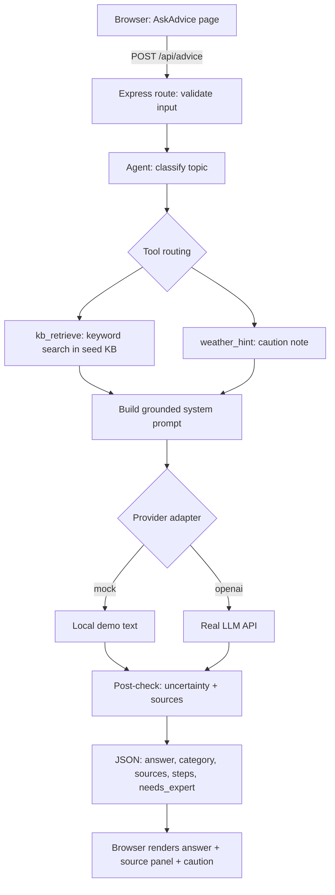

# বাংলা কৃষি সহায়ক — Voice-Based Bengali Crop Advisory AI Agent

MCA Final Year Project · Phase 1 (frontend) + Phase 2 (backend + basic AI agent workflow)

> **Safety first:** this is a *first-level informational* helper for Bengali-speaking farmers in
> West Bengal. It is **not** a diagnosis system and **not** a replacement for a qualified
> agricultural expert or Krishi Vigyan Kendra (KVK).

---

## 1. What is in this repository

```
voice-bengali-crop-advisory/
├── backend/                 Node.js + Express API + agent workflow + tests
│   ├── src/
│   │   ├── index.js         entry point (starts the server)
│   │   ├── server.js        Express app factory (CORS, JSON limit, routes, errors)
│   │   ├── config.js        reads .env once -> one config object
│   │   ├── logger.js        logs method/path/status/duration only (no question text)
│   │   ├── weather.js       live weather if WEATHER_API_KEY set, else labelled demo
│   │   ├── agent/
│   │   │   ├── agent.js     the agent pipeline (orchestrator) ⭐ study this first
│   │   │   ├── classify.js  step 1: which topic is the question? (keyword rules)
│   │   │   ├── retrieve.js  step 2: keyword retrieval from the local KB
│   │   │   └── prompt.js    step 3: grounded system prompt + safety rules
│   │   ├── providers/
│   │   │   └── adapter.js   provider adapter: mock (demo) and openai-compatible
│   │   ├── kb/seed.json     small curated knowledge base with source metadata
│   │   └── routes/          /api/advice + /api/health, /api/crop-guide, /api/weather
│   └── test/                node:test suites (21 tests)
└── frontend/                React + Vite UI (Bengali-first, mobile-first)
    └── src/
        ├── App.jsx          layout, nav, demo-mode banner (from /api/health)
        ├── pages/           Home, AskAdvice, CropGuide, Weather, About
        └── lib/api.js       small fetch client for the backend
```

## 2. Prerequisites

- **Node.js ≥ 20** (uses the built-in `node --test` runner and global `fetch`)
- npm 10+
- A modern browser (Chrome/Edge/Firefox)

## 3. Setup and run (two terminals)

```bash
# Terminal 1 — backend (http://localhost:4000)
cd backend
cp .env.example .env          # defaults are fine: LLM_PROVIDER=mock
npm install
npm start                     # or: npm run dev (auto-restart on change)

# Terminal 2 — frontend (http://localhost:5173)
cd frontend
cp .env.example .env          # default: VITE_API_BASE=http://localhost:4000
npm install
npm run dev
```

Open http://localhost:5173 — the yellow banner tells you the backend is in **demo (mock) mode**.

### Using a real LLM (optional)

Edit `backend/.env`:

```
LLM_PROVIDER=openai
LLM_API_KEY=your-key-here          # any OpenAI-compatible key
LLM_BASE_URL=https://api.openai.com/v1
LLM_MODEL=gpt-4o-mini
LLM_TIMEOUT_MS=12000
```

Restart the backend. The banner turns green ("লাইভ মোড").
**Never commit `.env`** — it is already in `.gitignore`. Only `.env.example` (placeholders) is committed.

### Optional live weather

```
WEATHER_API_KEY=your-openweathermap-key
WEATHER_PLACE=Barasat,West Bengal,IN
```

Without a key, `/api/weather` returns clearly labelled **demo** data.

## 4. API contract

### `GET /api/health`

```json
{ "status": "ok", "service": "bengali-crop-advisory-api", "version": "0.1.0",
  "provider": "mock", "demo_mode": true, "uptime_s": 12 }
```

### `POST /api/advice`

Request:

```json
{ "question": "ধানের ক্ষেতে পানি কীভাবে দেব?", "language": "bn", "crop": "ধান" }
```

| field | required | rules |
|---|---|---|
| `question` | yes | trimmed, 1–600 chars, plain string |
| `language` | no | `"bn"` (default) or `"en"` |
| `crop` | no | ≤ 60 chars |

Response `200`:

```json
{
  "answer": "সংক্ষেপে: ধান: পানি ব্যবস্থাপনা: …",
  "category": "irrigation",
  "language": "bn",
  "sources": [
    { "id": "kb-rice-water", "title_bn": "ধান: পানি ব্যবস্থাপনা", "title_en": "Rice …",
      "publisher": "Project demo seed entry (needs expert review)", "url": null,
      "reviewed_date": null, "needs_review": true, "score": 5.0,
      "matched_keywords": ["ধান", "পানি"] }
  ],
  "uncertainty": { "needs_expert": true, "reason": "mock_provider" },
  "provider": { "name": "mock", "model": "mock-v1", "demo": true },
  "steps": [
    { "tool": "classify", "label": "প্রশ্ন শ্রেণিবদ্ধ করা হয়েছে", "detail": "topic=irrigation" },
    { "tool": "route", "label": "টুল নির্বাচন (tool routing)", "detail": "kb_retrieve, weather_hint" },
    { "tool": "kb_retrieve", "label": "জ্ঞানভাণ্ডার থেকে তথ্য নেওয়া হচ্ছে", "detail": "2 entry/entries matched" },
    { "tool": "generate", "label": "ডেমো (mock) মডেলে উত্তর তৈরি", "detail": "no real LLM call" }
  ]
}
```

Errors (always JSON, safe messages):

| status | when |
|---|---|
| 400 | empty question / question > 600 chars / bad `language` / crop too long / invalid JSON |
| 413 | request body larger than 32 KB |
| 502 | LLM provider HTTP error or unreachable |
| 503 | provider misconfigured (no API key) |
| 504 | provider timeout (`LLM_TIMEOUT_MS`) |
| 404 | unknown route |

### `GET /api/crop-guide`

Public view of the same knowledge base the agent retrieves from (id, titles, summary, body,
caution, crops, topics, publisher, url, reviewed_date, needs_review).

### `GET /api/weather`

`{ live: false, demo_note: "…", data: { place, temp_c, humidity, rain_chance, wind_kph, condition, advice_bn } }`
— `live: false` whenever no provider is configured or the call fails.

## 5. How the agent works (beginner explanation)

1. **Endpoint** — a URL on the server (`/api/advice`) that accepts JSON and returns JSON.
2. **Classify** (`classify.js`) — tiny keyword rules decide the *topic*: `crop_problem`,
   `irrigation`, `pest`, `fertilizer` or `general`. This is the **tool-selection step** that makes
   this more than "one LLM call".
3. **Route** (`agent.js`, `ROUTES` table) — each topic is allowed specific tools
   (`kb_retrieve`, `weather_hint`). Look at the table, change a line, see the behaviour change.
4. **Retrieve** (`retrieve.js`) — a **small local knowledge base** (`kb/seed.json`) is scored by
   keyword overlap. Honest keyword retrieval, **not** a vector database — we do not claim full RAG.
5. **Ground** (`prompt.js`) — the retrieved snippets are pasted into the system prompt, so the
   model may only build on real entries. The prompt also forbids chemical dosages, forbids invented
   facts, and always recommends KVK/expert escalation when evidence is thin.
6. **Generate** (`providers/adapter.js`) — a **provider adapter** hides which model is used:
   `mock` (deterministic demo text, always flagged) or `openai` (any OpenAI-compatible endpoint).
   The adapter also handles timeouts via `AbortController`.
7. **Post-check** — if retrieval found nothing, or the provider is mock, the response carries
   `uncertainty.needs_expert = true` and the UI shows a caution box.



**Agent vs chatbot:** this is a *fixed pipeline with an explicit routing decision*, not a fully
autonomous agent. We say so plainly in the report and in the viva.

## 6. Environment variables (names only)

| name | where | purpose |
|---|---|---|
| `PORT` | backend | API port (default 4000) |
| `CORS_ORIGIN` | backend | allowed frontend origin(s), comma separated |
| `LLM_PROVIDER` | backend | `mock` or `openai` |
| `LLM_API_KEY` | backend | API key (never commit) |
| `LLM_BASE_URL` | backend | OpenAI-compatible base URL |
| `LLM_MODEL` | backend | model name |
| `LLM_TIMEOUT_MS` | backend | provider timeout |
| `WEATHER_API_KEY` | backend | optional live weather key |
| `WEATHER_PLACE` | backend | weather city query |
| `VITE_API_BASE` | frontend | backend base URL (public, no secrets!) |

## 7. Tests and checks (commands actually run)

```bash
cd backend  && npm test          # node --test  -> 21 tests
cd frontend && npm run build     # vite production build
```

Covered by tests: valid question, empty question, oversized question, invalid language, retrieval
hit, retrieval miss (uncertain), provider failure → 502, provider timeout → 504, missing API key →
503, mock-mode flags, health endpoint, crop-guide endpoint, weather demo endpoint, 404 route.
See `IMPLEMENTATION_REPORT.md` for the exact output summary.

## 8. Limitations (honest list)

- Default mode uses a **mock model** — answers are assembled from the seed KB, not a real LLM.
- The knowledge base is **small, unreviewed demo content** (every entry has `needs_review: true`).
- Retrieval is keyword-based; no embeddings, no reranking, no full RAG.
- No speech-to-text, no text-to-speech, no crop-image disease model, no live weather by default.
- No user accounts, no database, no analytics — intentionally out of scope for this milestone.
- The UI language is Bengali-first; English answers only when `language=en` is requested.

## 9. Phase 3 (remaining work)

1. **Speech-to-text** (browser Web Speech API or a server STT model) + **text-to-speech** for the
   answer, with a proper recording UX and privacy notice.
2. **Live weather** by default (provider key + per-district locations) integrated into advice.
3. **Crop image → disease** model (transfer learning or a hosted vision API), with confidence
   output and honest "seek expert" fallback.
4. **Richer RAG**: embeddings + vector store, chunked documents, source highlighting, evaluation set.
5. **Evaluation**: a golden question set with expert-reviewed expected answers; measure grounding
   and escalation quality; user feedback button (thumbs up/down) stored without personal data.
